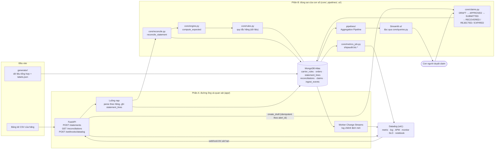
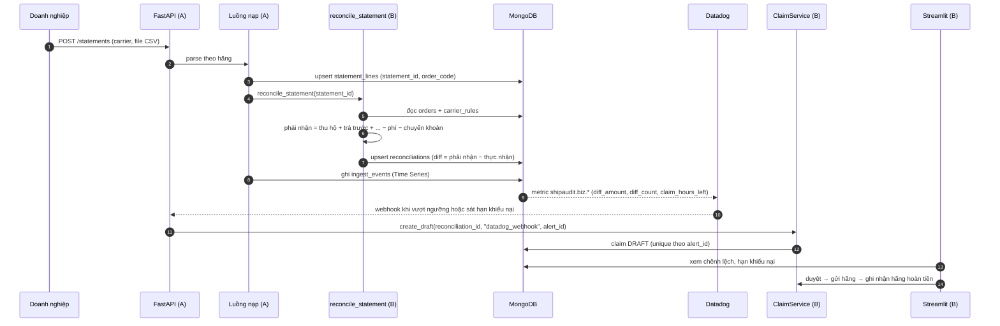
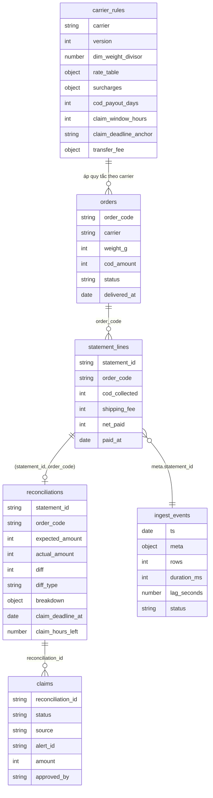
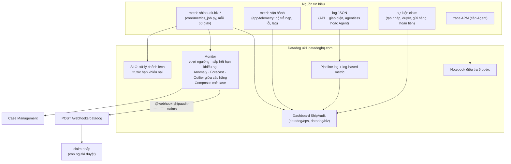

# Kiến trúc ShipAudit

ShipAudit tính **số tiền phải nhận** của từng đơn theo quy tắc từng hãng, so với **số tiền thực nhận** trong bảng kê,
cảnh báo chênh lệch theo **hạn khiếu nại**. Tài liệu này gồm bốn sơ đồ (Mermaid, GitHub tự vẽ): kiến trúc tổng thể,
luồng dữ liệu, mô hình dữ liệu MongoDB và kiến trúc quan sát trên Datadog. Hãng trong demo là hãng giả Carrier A/B/C,
dữ liệu tổng hợp (seed cố định 42).

## 1. Kiến trúc tổng thể

Hai phần chỉ chạm nhau qua `contracts/` (giao diện, schema, mẫu). `core/` không import từ `app/`; `ui/` chỉ đọc Mongo
qua `core/queries.py`, không gọi API của A. Không dùng AI hay LLM để tính tiền; con người duyệt claim trước khi gửi hãng.

## 2. Luồng dữ liệu: từ bảng kê đến claim

Tính đúng một lần: `reconcile_statement` idempotent theo `(statement_id, order_code)`, `create_draft` idempotent theo
`alert_id`, nên nạp lại hoặc webhook gửi lại không tạo bản ghi trùng.

Công thức đối soát (cài ở `Breakdown.expected_amount` trong `contracts/interfaces.py`, có test
`tests/core/test_breakdown_formula.py`):

> Tiền đối soát = Tiền thu hộ + Doanh nghiệp trả trước + Doanh nghiệp trả phí khi trả hàng − Phí giao hàng − Phí bảo hiểm − Phí chuyển hoàn
> − Phí lưu kho − Phí thay đổi địa chỉ − Phí đồng kiểm + Khuyến mãi − Phí chuyển khoản. Chênh lệch = phải nhận − thực nhận.

Năm loại chênh lệch: `FEE_MISMATCH`, `RETURN_FEE_DOUBLE`, `MISSING_IN_STATEMENT`, `COD_MISMATCH`, `LATE_PAYOUT`.

## 3. Mô hình dữ liệu MongoDB

Schema chính thức ở `contracts/schemas/*.json`; sơ đồ dưới đây chỉ nêu trường chính.

Quy tắc hãng là dữ liệu trong `carrier_rules`: đổi tham số hãng không phải sửa code. Tiền là số nguyên VNĐ, không dùng float
(`core/money.py`). `ingest_events` là Time Series (có TTL 14 ngày, tự chuyển sang collection thường nếu gói Atlas không hỗ trợ).

## 4. Kiến trúc quan sát trên Datadog

Dashboard, monitor, SLO, notebook xuất JSON ở `datadog/ops/` và `datadog/biz/`; tạo lại bằng
`python datadog/ops/apply.py` và `python datadog/biz/apply.py`. Id đã tạo ghi ở `deployed.json`. Khi chưa có Datadog,
metric in ra console (fallback trong `Metrics`).

## 5. Bảng ánh xạ thư mục

| Thư mục | Vai trò | Phần |
|---|---|---|
| `contracts/`, `common/` | giao diện, schema, mẫu, enum dùng chung | A + B |
| `app/` | API, luồng nạp, worker Change Streams, telemetry, webhook | A |
| `core/` | quy tắc hãng, engine, đối soát, claims, index, truy vấn, job metric | B |
| `pipelines/` | Aggregation Pipeline (chênh lệch theo hãng, xu hướng, claim sắp hết hạn, đơn thiếu...) | B |
| `generator/` | dữ liệu tổng hợp, chèn 5 loại chênh lệch, `labels.json` làm đáp án kiểm thử | B |
| `ui/` | giao diện Streamlit (tổng quan, chênh lệch, chi tiết đơn, hạn khiếu nại, so sánh hãng, claims, thông tin hãng) | B |
| `datadog/ops/`, `datadog/biz/` | dashboard, monitor, SLO, notebook (JSON + `apply.py`) | A / B |
| `scenarios/ops/`, `scenarios/biz/` | kịch bản sự cố vận hành và nghiệp vụ | A / B |
| `tests/` | test theo từng phần; golden test khớp từng đồng trên dữ liệu seed | A + B |
